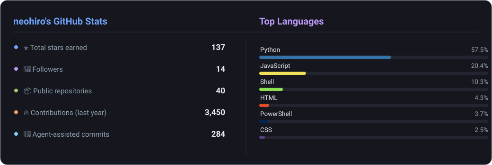

<h1 align="center">👽 METAPOD</h1>

  <b><i>"Defense is the best defense."</i></b> 🛡️ 
  Open-source <b>security hardening</b> & <b>privacy tools</b> for Windows & Linux

### 🛡️ What I build

🔒 Endpoint hardening & debloating · 🌐 LoRa mesh applications · 🕸️ Honeypots & traffic monitoring · 🧩 Practical Python utilities

### ⚔️ Featured projects

| Project | Description |
| --- | --- |
|  | Windows Exploit Protection settings (Ultimate) GUI |
|  | Cross-platform GUI for dnscrypt-proxy |
|  | Network hardening · DNS sinkhole · firewall · domain filter |
|  | Self-healing OpenCode sessions · retries · model rotation · autopilot |
|  | Cross-platform .ics/WebCal weather · air quality · astronomy feed |
|  | Passive honeypot for home networks · detects scans, brute-force, IoT malware |
|  | IPv4 + IPv6 DNS lookup · records, reverse lookups, diagnostics |
|  | Role-aware multi-slot LoRa firmware · Meshtastic and MeshCore on one radio |

### 🔐 Hardening guides

| Guide | Description |
| --- | --- |
|  | STIG-style manual + automated Windows 10/11 new-install hardening checklist |
|  | Post-install Linux hardening: firewall, encrypted DNS, Tor routing, fail2ban |

### 🧰 Toolbox

### 📊 GitHub stats

  

### 🔗 Links

<table width="100%" align="center">
  <tbody>
    <tr>
      <td align="center" width="33.33%">🌐 <a href="https://neohiro.github.io">neohiro</a></td>
      <td align="center" width="33.33%">🔑 <a href="https://neohiro.github.io/mesh-vanity-key">mesh-vanity-key</a></td>
      <td align="center" width="33.33%">🧬 <a href="https://transhumanists.github.io">transhumanists</a></td>
    </tr>
    <tr>
      <td align="center" width="33.33%">🎬 <a href="https://frenzypenguin.media">frenzypenguin.media</a></td>
      <td align="center" width="33.33%">🏝️ <a href="https://openstageis.land">openstageis.land</a></td>
      <td align="center" width="33.33%">🔗 <a href="https://domail.space">domail.space</a></td>
    </tr>
  </tbody>
</table>

---

  

  🌐 <b><a href="https://neohiro.github.io" rel="noopener noreferrer nofollow">neohiro.github.io</a></b>  
    
  

